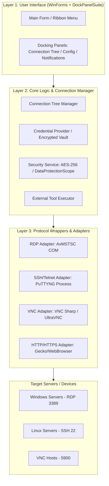
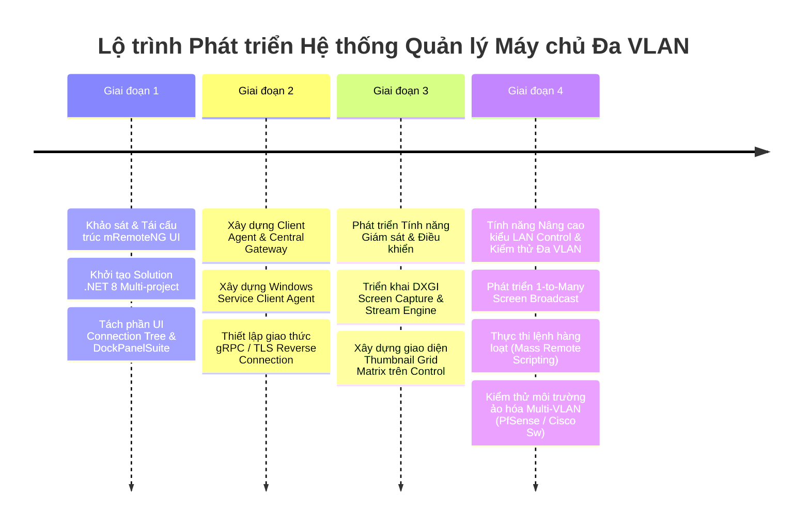

# Phân Tích mRemoteNG & Kế Hoạch Phát Triển Hệ Thống Quản Lý Máy Chủ - Máy Khách (Kiểu LAN Control) Hỗ Trợ Đa VLAN

## Executive Summary
Báo cáo này tập trung vào hai phần chính:
1. **Phân tích chuyên sâu repo mRemoteNG**: Cơ chế hoạt động, kiến trúc phần mềm, các giao thức tích hợp và khả năng mở rộng.
2. **Thiết kế kiến trúc hệ thống Client-Server kiểu LAN Control**: Chuyển đổi từ mô hình kết nối thụ động (Agentless Connection Aggregator) sang mô hình quản lý tập trung chủ động (Client-Server Agent Architecture) có khả năng hoạt động mượt mà xuyên suốt các phân đoạn mạng Đa VLAN (Multi-VLAN).

---

## Part 1: Phân Tích Chuyên Sưu Repo mRemoteNG

### 1. Tổng Quan Kiến Trúc (Architecture Overview)
mRemoteNG (mRemote Next Generation) là ứng dụng mã nguồn mở trên hệ điều hành Windows (viết bằng C# / .NET / WinForms) hoạt động theo mô hình **Connection Aggregator** (Bộ gom cụm kết nối điều khiển từ xa).



#### Các đặc trưng kỹ thuật chính:
* **Khung giao diện (UI Framework):** Sử dụng **DockPanel Suite** - thư viện tạo giao diện dạng tab/docking giống Microsoft Visual Studio, cho phép ghim, nhúng, tách hoặc ghép nhiều cửa sổ kết nối vào một khung làm việc duy nhất.
* **Tích hợp ActiveX / COM Control:** Đối với giao thức **RDP**, mRemoteNG nhúng trực tiếp thành phần `AxMsTscAxNotSafeForScripting` (thư viện COM `mstscax.dll` sẵn có của Windows).
* **Process Wrapping / App-Embedding:** Đối với **SSH/Telnet**, mRemoteNG khởi chạy tiến trình con `PuTTYNG.exe` (bản fork của PuTTY), dùng Win32 API (`SetParent`) để nhúng cửa sổ console của PuTTY vào một thẻ DockPanel.
* **Lưu trữ Cấu hình (Persistence):** Dữ liệu danh sách máy chủ mặc định lưu dạng XML (`confCons.xml`) hoặc SQL Database (MySQL / SQL Server) hỗ trợ làm việc nhóm. Mật khẩu được mã hoá bằng thuật toán **AES-256** hoặc **DPAPI (Data Protection API)**.

---

### 2. Các Chức Năng Cốt Lõi Của mRemoteNG
1. **Multi-Protocol Support:** Hỗ trợ RDP, VNC, SSH, Telnet, ICA (Citrix), HTTP/HTTPS, Raw Sockets, Rlogin.
2. **Credential Manager & Inheritance:** Cho phép thiết lập thông tin đăng nhập ở Folder cha và tự động kế thừa (Inherit) xuống các máy con.
3. **Port Scanning & Auto Discovery:** Tích hợp bộ quét IP/Port cơ bản để phát hiện các cổng mở (3389, 22, 5900) trong dải IP.
4. **External Tools Integration:** Cho phép thêm các công cụ tùy biến (ví dụ: Ping, Tracert, Nmap, PowerShell, FileZilla) và truyền biến số tự động (`%IP%`, `%USERNAME%`, `%PASSWORD%`, `%PORT%`).

---

### 3. Đánh Giá Khả Năng Mở Rộng & Hạn Chế
* **Ưu điểm để tái sử dụng:**
  * Khung quản lý cây kết nối (Connection Tree), giao diện tab/docking mạnh mẽ.
  * Bộ quản lý credential và mã hóa an toàn.
  * Khung lưu trữ cấu hình SQL/XML đã sẵn có.
* **Nhược điểm & Hạn chế so với LAN Control:**
  * **Mô hình Agentless thụ động:** mRemoteNG không có Service chạy ngầm trên máy khách (No Client Agent). Nó phụ thuộc hoàn toàn vào dịch vụ chuẩn của HĐH (RDP service, SSH daemon, VNC server).
  * **Thiếu khả năng Giám sát Thời gian thực (Real-time Monitoring):** Không thể xem màn hình xem trước (Thumbnail Matrix) của 50-100 máy cùng lúc.
  * **Thiếu khả năng Truyền tin 1-N (One-to-Many Broadcasting):** Không thể chiếu màn hình máy quản trị ra đồng loạt hàng loạt máy trạm.
  * **Không thể vượt qua ranh giới VLAN phức tạp:** Không có cơ chế Reverse Connection hoặc Central Gateway Server để kết nối các máy trạm nằm sau NAT/Firewall/VLAN khác subnet mà không mở port trực tiếp.

---

## Part 2: Kiến Trúc Hệ Thống Quản Lý Máy Chủ - Máy Khách (Kiểu LAN Control) Hỗ Trợ Đa VLAN

Để phát triển một phần mềm quản lý như **LAN Control School / LAN Control Manager** dựa trên nền tảng/ý tưởng của mRemoteNG, chúng ta cần chuyển đổi mô hình từ **Agentless Aggregator** sang **Client-Server-Gateway Architecture**.

```mermaid
flowchart TD
    subgraph ControlZone ["Control Zone (Quản trị / Teacher Station)"]
        CTRL[Master Control Console\n(Dựa trên mRemoteNG UI Framework)]
    end

    subgraph CentralGatewayZone ["Core Network / Data Center"]
        GW[Central Gateway / Name Server\n(gRPC / WebSocket Relay / REST API)]
        DB[(Database: Agents, Groups,\nPolicies, Audit Logs)]
        GW <--> DB
    end

    subgraph VLAN10 ["VLAN 10: Phòng Kỹ Thuật (192.168.10.0/24)"]
        A1[Client Agent 10.1]
        A2[Client Agent 10.2]
    end

    subgraph VLAN20 ["VLAN 20: Phòng Kế Toán (192.168.20.0/24)"]
        B1[Client Agent 20.1]
        B2[Client Agent 20.2]
    end

    subgraph VLAN30 ["VLAN 30: Máy Chủ / Branch Office (10.0.30.0/24)"]
        C1[Client Agent 30.1]
        C2[Client Agent 30.2]
    end

    CTRL <==>|Central Management API / Live Video Stream| GW
    A1 ==>|Outbound TLS Tunnel / TCP 8443| GW
    A2 ==>|Outbound TLS Tunnel / TCP 8443| GW
    B1 ==>|Outbound TLS Tunnel / TCP 8443| GW
    B2 ==>|Outbound TLS Tunnel / TCP 8443| GW
    C1 ==>|Outbound TLS Tunnel / TCP 8443| GW
    C2 ==>|Outbound TLS Tunnel / TCP 8443| GW
```

---

### 1. Giải Pháp Xử Lý Mạng Đa VLAN (Multi-VLAN Network Handling)

#### Thách thức của mạng Đa VLAN:
* Broadcast UDP (NetBIOS, mDNS, ARP scan) bị chặn tại Router/L3 Switch giữa các VLAN.
* Firewall ngăn chặn kết nối chủ động (Inbound) từ máy Quản trị tới các máy trạm ở VLAN bảo mật cao.

#### Giải pháp Kiến trúc (3 Trụ Cột Cốt Lõi):

1. **Reverse Agent Connection (Kết nối Ngược Tập Trung):**
   * **Cơ chế:** Ngay khi khởi động, **Client Agent** (chạy ngầm dưới dạng Windows Service) tự động thiết lập một kết nối Outbound TCP/TLS (hoặc gRPC/WebSocket) cố định về **Central Gateway Server** (IP/FQDN cố định, cổng 443 hoặc 8443).
   * **Lợi ích:** Không cần mở port Inbound tại từng máy khách; dễ dàng đi xuyên qua Firewall giữa các VLAN.

2. **Central Name Server & Agent Discovery (Trung tâm Điểm danh & Định tuyến):**
   * Central Gateway giữ danh sách kết nối active (Keep-Alive / Heartbeat 5s).
   * Quản trị viên chỉ cần kết nối tới Gateway là có thể thấy toàn bộ máy khách thuộc mọi VLAN được phân quyền.

3. **Multi-Subnet IP Range Probing (Dành cho máy chưa cài Agent):**
   * Gateway cung cấp bộ quét chủ động (Active Subnet Probe Engine). Master Control gửi yêu cầu quét danh sách dải IP (`192.168.10.0/24`, `192.168.20.0/24`, ...), Gateway thực hiện quét TCP SYN / Ping từ hạ tầng trung tâm và trả kết quả về Console.

---

### 2. Các Thành Phần Hệ Thống (Detailed System Components)

#### Module 1: Client Agent (Dịch vụ Máy khách)
* **Công nghệ:** C# .NET 8 / C++ Windows Service + Native Win32 API.
* **Tính năng:**
  * **Screen Capturing Engine:** Sử dụng **DXGI Desktop Duplication API** (hoặc GDI fallback) cho tốc độ chụp màn hình 30-60 FPS với chi phí CPU cực thấp (< 3%).
  * **Input Control & Intercept:** Dùng Low-Level Keyboard/Mouse Hooks (`SetWindowsHookEx`) để khóa bàn phím/chuột khi có lệnh Lock Screen.
  * **Remote Execution Service:** Nhận lệnh và thực thi PowerShell / CMD / Bash script theo quyền System.
  * **Hardware/Software Inventory Collector:** Thu thập thông tin CPU, RAM, Disk, Process, danh sách phần mềm cài đặt qua WMI / System.Management.

#### Module 2: Central Gateway / Gateway Proxy (Máy Chủ Trung Tâm)
* **Công nghệ:** ASP.NET Core Kestrel / gRPC Server / SignalR Server.
* **Tính năng:**
  * **Connection Multiplexing:** Quản lý đồng thời hàng nghìn kết nối Agent song song.
  * **Stream Relay Engine:** Nhận mã hóa hình ảnh H.264/VP8/MJPEG từ Agent và phân phối đến Master Console.
  * **Authentication & Authorization:** Xác thực bằng JWT Token, mã hóa toàn bộ dữ liệu truyền tải bằng TLS 1.3.

#### Module 3: Master Control Console (Trạm Quản Trị kiểu LAN Control)
* **Công nghệ:** Kế thừa & phát triển từ UI của **mRemoteNG** (C# WinForms / WPF với DockPanelSuite / AvalonDock).
* **Giao diện & Chức năng Cốt Lõi:**
  * **Lưới xem trước màn hình (Thumbnail Matrix View):** Hiển thị màn hình thu nhỏ dạng Grid của 10 - 100 máy trạm thuộc các VLAN cùng lúc (update 1-5 FPS cho thumbnail grid).
  * **Tabbed Full Screen Remote Desktop:** Khi nhấp đúp vào 1 máy trạm, mở thẻ kết nối điều khiển độ nét cao (RDP hoặc Native Custom Stream).
  * **Màn hình Phát sóng (1-to-Many Screen Broadcast):** Chụp màn hình máy Quản trị -> Gateway -> Phát đồng loạt (Stream) tới tất cả hoặc một nhóm Agent được chọn.
  * **Điều khiển Hàng loạt (Mass Command & Scripting):** Gửi lệnh tắt máy, khởi động lại, chạy file `.bat`/`.ps1` tới hàng loạt máy được chọn trong bảng danh sách.
  * **Phân vùng Cây Kết nối Theo VLAN / Phòng Ban:** Cho phép gom nhóm theo VLAN (VLAN 10 - Kỹ thuật, VLAN 20 - Kế toán) hoặc theo Vị trí Địa lý.

---

### 3. So Sánh Kiến Trúc: mRemoteNG vs. Hệ Thống Mới (LAN Control-like)

| Tiêu chí | mRemoteNG (Hiện tại) | Hệ thống Mới (LAN Control-like) |
| :--- | :--- | :--- |
| **Mô hình** | Agentless (Kết nối trực tiếp) | Client-Server-Gateway (Agent-based) |
| **Hỗ trợ Đa VLAN** | Phụ thuộc routing/NAT của mạng | Rất tốt nhờ Outbound Reverse Tunnel qua Gateway |
| **Giám sát thời gian thực** | Không hỗ trợ (Chỉ mở 1-1 session) | Hỗ trợ lưới Thumbnail Matrix giám sát 100+ máy cùng lúc |
| **Phát sóng màn hình (Broadcast)**| Không hỗ trợ | Hỗ trợ 1-N Screen Streaming (Teacher -> Students) |
| **Quản lý Hàng loạt** | Rất hạn chế (External tools 1-1) | Thực thi lệnh, khóa máy, gửi file hàng loạt |
| **Cơ chế An toàn** | AES-256 mã hóa file config | TLS 1.3 + JWT Token + System Service Protection |

---

## Part 3: Lộ Trình Phát Triển Chi Tiết (Implementation Roadmap)



### Bước 1: Khởi tạo Cấu trúc Solution (.NET 8/9)
```text
LAN ControlManager.sln
├── src/
│   ├── LanControl.Control/          # Master Console App (Phát triển từ mRemoteNG UI)
│   ├── LanControl.Agent/            # Client Service (Windows Service)
│   ├── LanControl.Gateway/          # Central Server (ASP.NET Core gRPC/SignalR)
│   ├── LanControl.Core/             # Thư viện dùng chung (Protocols, DTOs, Crypto)
│   └── LAN Control.CaptureNative/    # C++ CGO / DXGI Screen Capture Library
```

### Bước 2: Thiết Lập Giao Thức gRPC (Proto Schema)
```protobuf
syntax = "proto3";

package lancontrol;

service AgentGatewayService {
  // Agent đăng ký kết nối ngược từ VLAN về Gateway
  rpc RegisterAgent (AgentInfo) returns (stream ControlCommand);
  // Stream màn hình từ Agent về Server
  rpc StreamScreen (stream ScreenFrame) returns (CommandResponse);
}

message AgentInfo {
  string agent_id = 1;
  string hostname = 2;
  string ip_address = 3;
  string vlan_tag = 4;
  string os_version = 5;
}

message ScreenFrame {
  string agent_id = 1;
  bytes image_data = 2;
  int64 timestamp = 3;
}

message ControlCommand {
  string command_type = 1; // LOCK_SCREEN, EXECUTE_PS, CAPTURE_NOW
  string payload = 2;
}
```

---

## Conclusion & Recommendations

1. **Khả năng tận dụng mRemoteNG:** 
   * Bạn hoàn toàn có thể kế thừa **hơn 60% giao diện mRemoteNG** (Cây thư mục kết nối, hệ thống Tab kết nối, Quản lý Credentials, DockPanel layout).
2. **Điểm cần thay đổi cốt lõi:**
   * Thay thế hoặc bổ sung thêm module giao thức kết nối: Bên cạnh RDP/SSH chuẩn, tích hợp thêm **LAN Control Protocol Engine** kết nối qua Central Gateway bằng gRPC.
3. **Môi trường Đa VLAN:**
   * Việc triển khai **Central Gateway Server** làm cầu nối kết nối ngược (Reverse Connection) là giải pháp tối ưu nhất, giải quyết triệt để bài toán rào cản IP/Subnet/Firewall giữa các VLAN trong doanh nghiệp và trường học.
